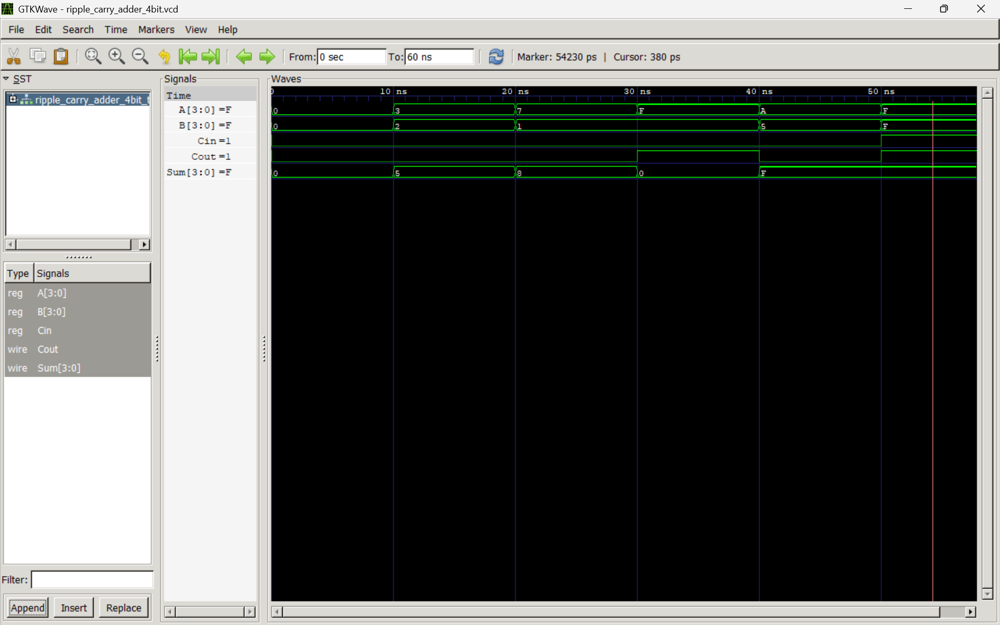

# RTL-to-GDSII Implementation of a 4-Bit Ripple Carry Adder

A hands-on VLSI project implementing a 4-bit Ripple Carry Adder using Verilog HDL, with the goal of completing the RTL-to-GDSII design flow using the SkyWater SKY130 PDK.

## Project Overview

This project explores the digital design and ASIC implementation flow, starting from RTL development and functional verification and progressing towards synthesis and physical design.

## Objectives

- Design a 1-bit Full Adder using Verilog HDL.
- Implement a 4-bit Ripple Carry Adder using structural modeling.
- Verify functionality through simulation and testbenches.
- Perform logic synthesis using Yosys.
- Explore physical design using OpenROAD and SKY130 PDK.
- Understand timing, area, and physical implementation results.

## Architecture

The 4-bit Ripple Carry Adder consists of four Full Adder modules connected in series.

The carry output of each Full Adder is connected to the carry input of the next stage.

## Tools and Technologies

- Verilog HDL
- Icarus Verilog
- GTKWave
- Yosys (planned)
- OpenROAD (planned)
- SkyWater SKY130 PDK (planned)

## Project Workflow

1. RTL Design
2. Functional Verification
3. Logic Synthesis
4. Floorplanning and Placement
5. Routing
6. Physical Verification
7. GDSII Generation

## Current Progress

### Completed

- [x] Full Adder RTL design
- [x] Full Adder testbench and functional simulation
- [x] 4-bit Ripple Carry Adder structural RTL design
- [x] RCA testbench development
- [x] Functional verification with six test cases
- [x] Carry propagation debugging and verification
- [x] GTKWave waveform inspection
- [x] Yosys synthesis and SKY130HD technology mapping
- [x] Floorplanning and power distribution network setup
- [x] Standard-cell placement
- [x] Clock-tree synthesis (CTS) flow execution
- [x] Global routing
- [x] Detailed routing with zero routing violations
- [x] Parasitic extraction
- [x] Final timing and physical reports generated
- [x] Final GDSII layout generation
- [x] KLayout layout inspection
- [x] LVS verification — netlists match
- [x] VDD and VSS power connectivity checks

### Verification Review

- [x] Detailed routing report generated
- [x] LVS comparison passed
- [ ] Review final DRC report and confirm rule-check results
## 4-Bit RCA Simulation

The following waveform shows the functional simulation of the 4-bit Ripple Carry Adder using Icarus Verilog and GTKWave.

## Learning Outcomes

This project aims to develop practical understanding of:

- Combinational logic design
- Hierarchical and structural RTL modeling
- Carry propagation in adders
- Functional verification
- RTL synthesis
- ASIC physical design flow

## Project Status

**Current Stage: RTL-to-GDSII Implementation Completed**

### Completed
- RTL design and functional verification
- Yosys synthesis and SKY130HD technology mapping
- Floorplanning and power distribution network setup
- Placement and clock-tree synthesis (CTS)
- Global routing and detailed routing
- Parasitic extraction and final timing reports
- Final GDSII layout generation
- KLayout layout inspection
- LVS verification — netlists match

### Physical Verification Notes
- Detailed routing completed with 0 routing violations.
- LVS verification passed.
- DRC report generated; final rule-check results are subject to report review.
- Power connectivity checks completed for VDD and VSS.

**Note:** This is an educational RTL-to-GDSII implementation using the OpenROAD flow and SKY130HD platform. Results are not presented as foundry signoff.

